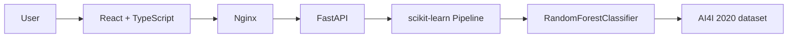

# InduSight AI


InduSight AI is a predictive maintenance monitoring platform that combines a React + TypeScript dashboard with a FastAPI inference layer backed by a trained machine learning model. The system estimates failure risk from industrial sensor readings and exposes the result through a lightweight, Dockerized architecture designed for local development and portfolio demos.

## Overview

Industrial machines generate continuous sensor readings that can reveal early signs of degradation before a failure occurs. InduSight AI addresses this by training a Random Forest classifier on the AI4I 2020 Predictive Maintenance dataset and serving the model through a FastAPI API.

The frontend visualizes fleet health, machine-level risk, and sensor trends, while the backend loads a persisted sklearn pipeline and responds to prediction requests without retraining the model during inference. This keeps the application easy to run locally and easy to explain in a portfolio or technical review.

## Features

- Industrial monitoring dashboard
- Machine fleet overview
- Failure probability prediction
- Machine detail view
- Sensor time-series visualization
- Feature importance breakdown
- Model metadata endpoint
- FastAPI inference API
- Dockerized development environment
- Automated tests
- GitHub Actions CI

## Architecture



The UI and simulation layer also send prediction requests to the backend through the web app flow:

Frontend simulation -> POST /predict -> FastAPI -> trained model -> probability + risk level -> UI

## ML Pipeline

Dataset: AI4I 2020 Predictive Maintenance Dataset

Features used by the model:

- Air temperature
- Process temperature
- Rotational speed
- Torque
- Tool wear

Model: RandomForestClassifier

Preprocessing: SimpleImputer

Pipeline: preprocessing -> Random Forest -> probability output

The training logic is intentionally separated from the inference runtime. The model is trained offline and saved as a serialized sklearn artifact under artifacts/models. At runtime, the API loads the persisted pipeline from disk and does not retrain the model for each request.

## Model performance

The following metrics come from the existing trained artifact and represent the test split used during model development:

- ROC-AUC: 0.9688
- Precision: 0.8431
- Recall: 0.6324
- F1: 0.7227

Confusion matrix (test-set result):

- TN = 1924
- FP = 8
- FN = 25
- TP = 43

These figures are useful for demonstrating the trained model configuration and validation behavior, but they do not guarantee production performance in a live industrial environment.

## Backend API

The backend exposes the following endpoints:

- GET /health
- GET /model
- POST /predict
- GET /docs

### Example request for /predict

```json
{
  "machine_id": "M-1",
  "reading": {
    "air_temperature": 300.0,
    "process_temperature": 310.0,
    "rotational_speed": 1500.0,
    "torque": 40.0,
    "tool_wear": 120.0
  }
}
```

Example response fields include:

- prob_failure
- risk_level
- model_version
- feature_importances

## Frontend

The frontend includes:

- Dashboard summary cards
- Machine fleet overview
- Models view with model metadata
- Machine detail screen
- Sensor simulation logic
- Charts for probability trends and feature importance
- Risk labels such as healthy, warning, and critical

## Docker

Run the complete stack from the repository root:

```bash
docker compose up --build
```

Stop the environment with:

```bash
docker compose down
```

Access the services:

- Frontend: http://localhost/
- Backend: http://localhost:8000/
- Swagger: http://localhost:8000/docs

## Local development

If you want to override the local environment values, copy the repository root file [.env.example](.env.example) to `.env` and adjust only the values you need. No secrets or credentials are required for this project.

### Backend

From the project root:

```bash
python -m uvicorn backend.app.main:app --reload --host 127.0.0.1 --port 8000
```

### Frontend

```bash
cd frontend
npm install
npm run dev -- --host 127.0.0.1 --port 4173
```

### Test commands

Frontend tests:

```bash
cd frontend
npm run test -- --run
npx tsc --noEmit
```

Backend tests:

```bash
python -m pytest
```

## Testing

The project includes automated checks in both layers:

- Frontend: Vitest + Testing Library
- Backend: pytest

The current repository includes working tests for the API and the frontend behavior. The exact test count is determined by the test suite itself and can be verified with the commands above.

## CI

GitHub Actions runs automated checks for the repository on push and pull request events. The workflow verifies backend tests, frontend tests, TypeScript checks, and the Docker configuration/build path without changing the application architecture.

## Project structure

```text
.
├── .github/
│   └── workflows/
│       └── ci.yml
├── artifacts/
│   └── models/
├── backend/
│   ├── app/
│   ├── tests/
│   └── requirements.txt
├── frontend/
│   ├── src/
│   ├── package.json
│   └── package-lock.json
├── training/
├── docker-compose.yml
├── README.md
├── .gitignore
├── .env.example
└── .dockerignore
```

Responsibilities:

- artifacts/models: persisted trained ML artifact and metadata
- backend: FastAPI service and model-loading logic
- frontend: React + TypeScript + Vite dashboard
- training: training scripts and notebook-friendly material
- docker-compose.yml: orchestrates the local app stack
- .github/workflows: CI automation for quality checks

## Roadmap

The current project is intentionally kept focused on the MVP. Possible next steps include:

- real-time sensor ingestion
- persistent storage for predictions and historical data
- model registry and versioned releases
- automated retraining pipeline
- cloud deployment and observability

These remain future extensions and are not part of the current portfolio deliverable.

## License

A formal project license has not been chosen yet. Before publishing the repository publicly, define the preferred license and add it explicitly to the repository.

## GitHub and repository hygiene

This repository is intended to be ready for a public portfolio repository. The project keeps environment-specific values out of tracked files and relies on versioned artifacts such as the trained model so that a fresh clone can run the app without retraining.
